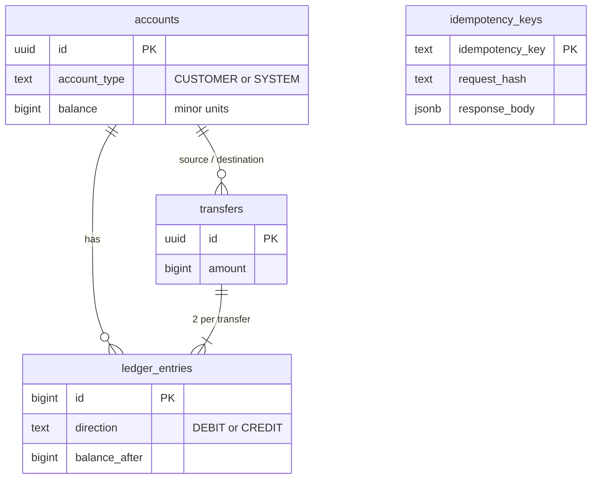

# Ledgerline


A money-transfer API built around two guarantees: **money is never created or destroyed** (double-entry
bookkeeping) and **a retried request never moves money twice** (idempotency keys). Both are verified by
parallel tests and a load test, not just asserted.

**Stack:** Java 21 (virtual threads) · Spring Boot 3.5 · PostgreSQL 16 · Flyway · Testcontainers · k6 · Micrometer/Prometheus · ArchUnit · GitHub Actions

## Features

- **Double-entry ledger**: every transfer writes exactly one debit and one credit entry, each with a running `balance_after`.
- **Idempotent writes**: mandatory `Idempotency-Key` header; retries replay the stored response, key reuse with a different payload is rejected (`422`), concurrent duplicates execute exactly once.
- **Deadlock-free concurrency**: pessimistic row locks acquired in sorted-id order; validation happens only after locks are held.
- **Integrity enforced in the database**: constraint trigger rejects unbalanced entries at commit, ledger is append-only, customer balances can't go negative.
- **Reconciliation endpoint**: audits the whole ledger in one `REPEATABLE READ` snapshot.
- **Production hygiene**: RFC 9457 problem responses, OpenAPI/Swagger UI, Prometheus business metrics, graceful shutdown, multi-stage non-root Docker image, CI.

## Architecture

```mermaid
sequenceDiagram
    participant C as Client
    participant API as TransferController
    participant I as IdempotencyService
    participant T as TransferService
    participant DB as PostgreSQL
    C->>API: POST /api/v1/transfers (Idempotency-Key)
    API->>I: execute(key, request fingerprint)
    I->>DB: BEGIN; INSERT key ON CONFLICT DO NOTHING
    alt key already completed
        I->>DB: load stored response
        I-->>C: 201 + Idempotent-Replayed: true
    else new key
        I->>T: transfer(...)
        T->>DB: SELECT ... FOR UPDATE (both accounts, sorted by id)
        T->>DB: INSERT transfer, UPDATE balances, INSERT debit + credit
        I->>DB: store response; COMMIT
        Note over DB: deferred trigger checks debits = credits
        I-->>C: 201
    end
```



Deposits are transfers from a per-currency `SYSTEM` funding account, so total money across all accounts is always exactly zero.

## Design decisions

| Decision                                                       | Why                                                                                 |
| -------------------------------------------------------------- | ----------------------------------------------------------------------------------- |
| Amounts as `BIGINT` minor units                                | No floating-point error; overflow guarded by a max amount                           |
| `JdbcClient` + explicit SQL instead of JPA                     | Locking and idempotency behaviour stays visible and testable                        |
| Lock accounts in sorted-id order                               | Opposing transfers (A→B, B→A) contend on the same first lock instead of deadlocking |
| Idempotency claim + transfer + response in **one** transaction | A crash can never leave a half-applied transfer or an orphaned key                  |
| Failed requests roll back the key too                          | A transient or business failure doesn't burn the client's key                       |
| Constraint trigger for balanced entries                        | Even a buggy code path cannot commit an unbalanced transfer                         |

## Run it

```bash
docker compose up -d                     # PostgreSQL
./mvnw spring-boot:run                   # API on :8080, Swagger UI at /swagger-ui.html
# or everything in containers:
docker compose --profile app up --build -d
```

```bash
# create an account, deposit, transfer
curl -X POST localhost:8080/api/v1/accounts -H 'Content-Type: application/json' \
  -d '{"name":"Alice","currency":"EUR"}'
curl -X POST localhost:8080/api/v1/accounts/$ALICE/deposits \
  -H 'Content-Type: application/json' -H "Idempotency-Key: $(uuidgen)" \
  -d '{"amount":5000,"currency":"EUR"}'
curl localhost:8080/api/v1/reconciliation
```

## Testing

```bash
./mvnw verify
```

| Suite                          | What it proves                                                                                                                                                                         |
| ------------------------------ | -------------------------------------------------------------------------------------------------------------------------------------------------------------------------------------- |
| `SchemaIT`                     | The database itself rejects unbalanced entries, ledger mutation, negative balances                                                                                                     |
| `TransferServiceIT` / `*ApiIT` | Business rules and the HTTP contract                                                                                                                                                   |
| `IdempotencyIT`                | Replay, key reuse, failed-request retry, 16 simultaneous duplicates → one transfer                                                                                                     |
| `TransferConcurrencyIT`        | 1,600 opposing transfers without deadlock; 2,000 random transfers conserve money; hot account never overdrawn; deposits never lost; 100-request duplicate storm → exactly 25 transfers |
| `ReconciliationIT`             | The audit passes on a healthy ledger and detects tampering                                                                                                                             |
| `ArchitectureTest`             | Layering rules enforced in the build                                                                                                                                                   |

The concurrency tests were validated by mutation: removing the lock ordering makes the opposing-transfer test fail with
`deadlock detected`; removing `FOR UPDATE` makes the hot-account test fail.

## Load test

`k6/transfers.js`: ramping arrival rate of random transfers over 100 accounts, 10% immediate retries (must replay the
same transfer), 2% key-reuse attacks (must get `422`), and a concurrent hot-account scenario (exactly 100 of 500
attempts may succeed). The run fails on latency/error thresholds or any reconciliation violation afterwards.

```bash
docker run --rm -i --network host -v $(pwd)/k6:/scripts:ro grafana/k6 run \
  -e BASE_URL=http://localhost:8080 -e RATE=150 /scripts/transfers.js
```

| Metric                   | Result                                   |
| ------------------------ | ---------------------------------------- |
| Machine                  | _(CPU / RAM, app + DB + k6 on one host)_ |
| Sustained rate           | _(req/s)_                                |
| p95 / p99 latency        | _(ms)_                                   |
| Error rate               | _(%)_                                    |
| Hot account              | 100 / 500 succeeded, final balance 0     |
| Reconciliation after run | consistent                               |

## Observability

`/actuator/prometheus` exposes JVM and HTTP metrics plus `ledgerline_transfers_completed_total{type}`,
`ledgerline_idempotency_replays_total{operation}` and `ledgerline_errors_total{code}`.

## Known limitations / next steps

- No authentication; idempotency keys are global rather than scoped per client.
- Single-currency transfers only (no FX).
- Possible extensions: transactional outbox for transfer events, partitioning `ledger_entries` by time, reversal/refund transfers.
